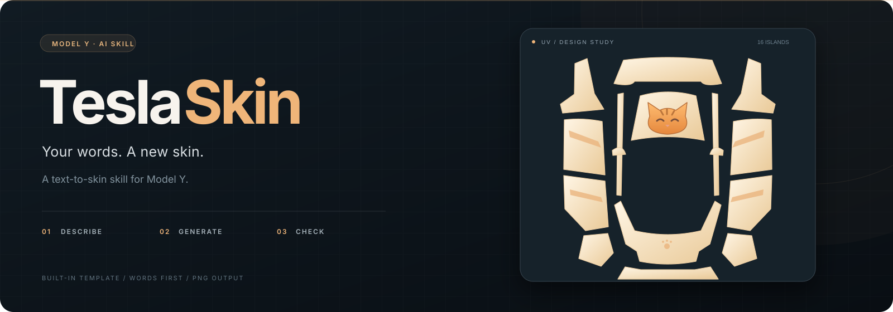
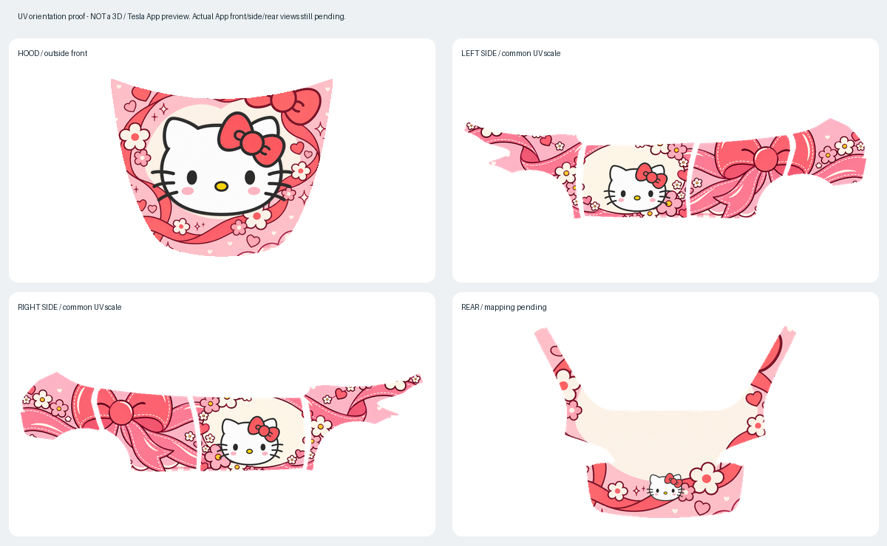
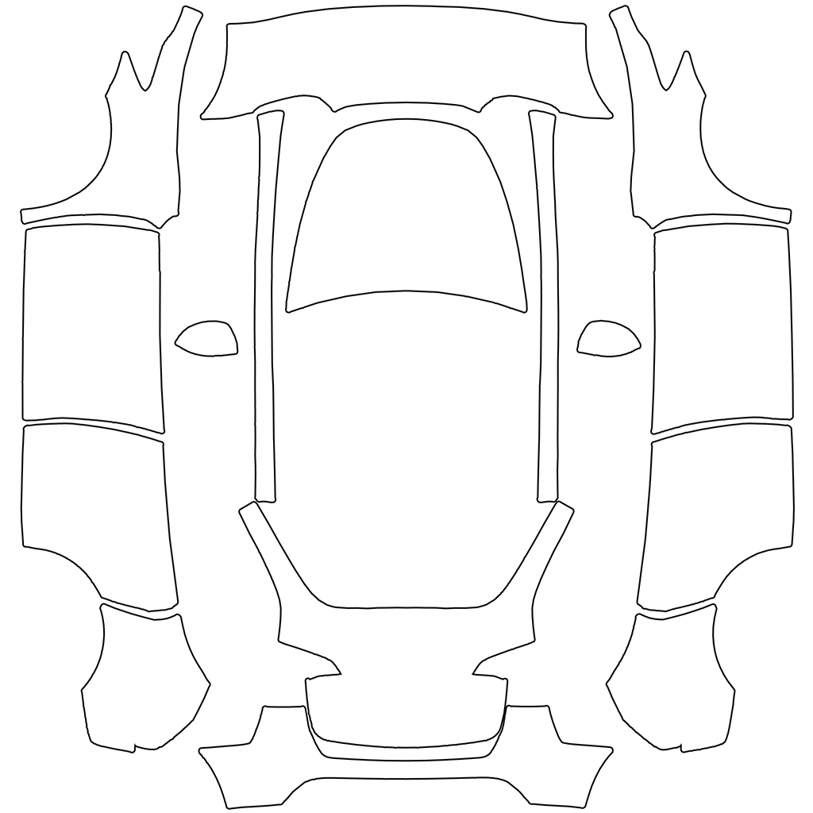
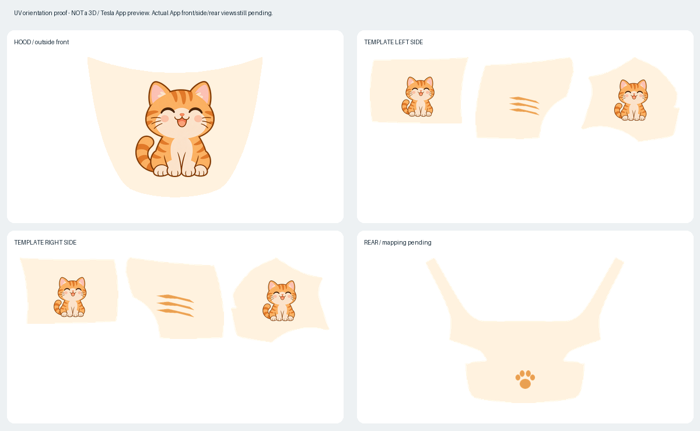

<p align="center">
  
</p>

<p align="center">
  <strong>用一句主题描述，开始制作你的 Model Y 车机皮肤。</strong><br />
  一句话补全设计 · 连贯背景 · 固定白版合成 · 分区旋转 · 压缩校验
</p>

<p align="center">
  <a href="skills/tesla-skin-generator/SKILL.md"></a>
  
  <a href="tests/"></a>
  <a href="LICENSE"></a>
</p>

<p align="center">
  <a href="#安装">安装</a> · <a href="#使用">使用</a> · <a href="#生成示例与实测状态">生成示例</a> · <a href="#检查与测试">检查与测试</a> · <a href="skills/tesla-skin-generator/SKILL.md">技能指令</a>
</p>

---

> **推荐基于 ChatGPT 运行本技能，以获得最佳使用体验。** 优先选择同时支持 Skills、内置生图和文件处理的环境，便于在同一对话中完成白版编辑、持续修改、超限压缩与检查。不同入口、套餐和工作区的工具可用性可能不同，请确认当前会话具备相应能力。

## 从想法开始

> 用 `$tesla-skin-generator` 生成一款奶油白底、橘猫主题、简洁可爱的 Model Y 皮肤。

TeslaSkin 是运行在支持 Agent Skills 和内置生图能力环境中的技能。你只需描述主题或气质，助手会自动补齐配色、主视觉、贯穿纹样、装饰细节和分区安排，无需先写完整设计需求或提供参考图片。AI 生成画稿，程序在固定白版上连续排布背景、旋转主体和导出，减少模型不执行尺寸、方向或轮廓约束的问题。

| 描述主题 | 生成与修改 | 检查与交付 |
| :--- | :--- | :--- |
| 只说主题或气质，细节自动补齐，默认制作一款 | AI 生成背景与正立主体，程序固定分区旋转与安全排布 | 清理边缘、必要时压缩并校验，保留设计 brief、素材、JSON 与提示词 |

### 一句话自动补齐设计

说“Hello Kitty 主题”就够了。技能会补充主辅配色、角色与装饰的关系、贯穿车身的构图、疏密变化及前/侧/后的分工，用几句话说明方向后直接制作，并保存 `.brief.md` 设计记录。

例如，可扩展为“草莓粉与奶油白、莓红强调，Kitty 融入缎带花环，丝带连接前后门，花朵和爱心沿路径聚散，格纹与尾部蝴蝶结呼应”。这只是一个设计方向，不是每款作品的固定配方。

你的明确要求始终优先：说“极简黑金”会细化线条、比例和呼应；说“纯黑底，只要一条红线”就保留单线设计；说“只改引擎盖”则仅补充该部位。自动补充不等于强行增加花纹，也不会擅自添加其他角色、品牌或标语。

> **当前状态：34 项本地测试通过。** 橘猫 v03 和 Hello Kitty 连贯背景版均通过文件、结构及边缘检查，完成平面方向与构图复核。旧版已有用户提供的 Tesla App 展示反馈；新版本的 App 前/侧/后及实车效果仍待确认。详见[验收记录](output/validation-summary.md)。

### 为什么推荐 ChatGPT

- **图案创作和固定白版衔接。** 本技能围绕 ChatGPT 的原生生图、图片编辑和对话式修改流程设计，并已在当前环境实测，可把生成的图案接入固定白版合成器。
- **在同一对话中持续调整。** 从“生成橘猫主题”到“只改引擎盖”，可以接续已有作品与修改要求，减少在多个工具间搬运图片、重复说明设计的操作。
- **将生成与交付衔接起来。** 具备文件处理及 Python 执行能力的环境，可继续运行随包的压缩和校验脚本，保留版本、提示词和处理报告。

这是基于本技能工作流设计的使用建议，不代表其他平台不能运行，也不保证生图必然满足精确 UV 要求。生成后仍需完整检查。相关能力及使用方式可参考 [ChatGPT 图片生成与编辑](https://learn.chatgpt.com/docs/image-generation)和 [Skills 官方说明](https://learn.chatgpt.com/docs/build-skills)。

## 安装

需要支持 Agent Skills 的运行环境、可用的内置生图工具，以及用于校验的 **Python 3 + Pillow**。技能本身不包含生图模型，也不要求单独配置 API Key；无生图工具时会明确说明，不自动切换到付费 API。

### 1. 获取项目

```powershell
git clone https://github.com/isunky/TeslaSkin.git
cd TeslaSkin
python -m pip install -r requirements.txt
```

### 2. 安装到个人 skills 目录

**Windows / PowerShell**

```powershell
$skillsDir = if ($env:CODEX_HOME) {
    Join-Path $env:CODEX_HOME 'skills'
} else {
    Join-Path $env:USERPROFILE '.codex\skills'
}
New-Item -ItemType Directory -Path $skillsDir -Force | Out-Null
Copy-Item -LiteralPath '.\skills\tesla-skin-generator' -Destination $skillsDir -Recurse
```

<details>
<summary>macOS / Linux</summary>

```bash
python3 -m pip install -r requirements.txt
mkdir -p "${CODEX_HOME:-$HOME/.codex}/skills"
cp -R skills/tesla-skin-generator "${CODEX_HOME:-$HOME/.codex}/skills/"
```

</details>

也可下载 [技能 ZIP 包](tesla-skin-generator.zip)，将其中的 `tesla-skin-generator` 文件夹放入个人 skills 目录。安装后在支持该技能的聊天中调用；已有同名技能时，请先备份你的自定义内容。

以上目录复制步骤适用于读取本地 skills 目录的环境。ChatGPT 中请使用当前客户端提供的技能入口；网页及手机端需通过包含该技能的插件使用。[官方支持范围](https://learn.chatgpt.com/docs/build-skills)

## 使用

**创建一款皮肤**

```text
用 $tesla-skin-generator 生成一款奶油白底、橘猫主题的 Model Y 皮肤。
简洁可爱，点缀少量猫爪，不要文字。
```

**通过对话继续修改**

```text
底色再淡一点，橘色保持不变。
```

```text
只修改引擎盖，把猫换成睡觉的姿势，其他部位保留。
```

每次制作会保存版本化 PNG、实际提示词和检查结果。示例目录：

```text
output/
├── orange-cat-v03-assets/          # 独立图案，后续修改可复用
├── <name>.brief.md                # 新生成作品的要求与补充设计
├── orange-cat-v03.design.json      # 分区排布和底色
├── orange-cat-v03.png              # 车机用 PNG
├── orange-cat-v03.prompt.txt
├── orange-cat-v03.composition.json
└── orange-cat-v03.validation.json
```

排布问题通过设计 JSON 修正，避免整套随机重画；素材问题最多进行一次定向生图修正。最终皮肤超过 1,000,000 字节时先压缩、保留原图，再检查实际交付文件；源素材不受车机导出文件的体积限制。

## 生成示例与实测状态

### 连贯背景设计：Hello Kitty

通过一条贯穿丝带组织主体、花朵、爱心与格纹的层级。同侧翼子板、前后门和后侧围共享一幅画稿，花纹不会在每块部件重新起图；脸部继续保留安全边距。装饰可以满版、跨分区延续，避免所有部件都以同样大小居中摆一个孤立图标。



[皮肤 PNG](output/hello-kitty-v02.png) · [设计 JSON](output/hello-kitty-v02.design.json) · [生成记录](output/hello-kitty-v02.prompt.txt)

1024×1024、866,170 字节，无需压缩；原模板 alpha 保持一致，越界杂点及车身区域遗漏为 0。上图是平面 UV 方向和构图检查，不是 3D/App 预览；实际车模跨缝效果仍待确认。

### 固定白版示例：橘猫

<table>
  <tr>
    <td align="center" width="50%"><strong>内置白版 · 几何基准</strong></td>
    <td align="center" width="50%"><strong>橘猫 v03 · 固定白版合成</strong></td>
  </tr>
  <tr>
    <td align="center"></td>
    <td align="center"></td>
  </tr>
  <tr>
    <td align="center">1024 × 1024 · 16 个主要白色分区</td>
    <td align="center">文件检查通过 · App / 实车待确认</td>
  </tr>
</table>

**分区方向检查图**（平面图案复核，不是 3D 或 App 效果预览）：



最新 v03：1024×1024、169,255 字节；模板 alpha 逐字节一致，越界可见像素、弱透明杂点和车身遗漏均为 0。引擎盖默认旋转 180°，展开图左侧 90°、右侧 270°，以车外观看时正立为优先。俯视控制页与车头外部观看无法保证同一方向都正立，可按用户偏好调整约定。

用户提供的旧版 App 截图确认了引擎盖倒向、门板横躺及边缘紫线问题；新流程改由程序定向排布，加入安全区和边缘清理。旧截图不作为新版本的 App 通过证据。原始截图未收入仓库。

<details>
<summary>首次整张 UV 生图的历史记录</summary>

2026-11-03 早期直接生整张 UV 图的结果如下；现已改为独立素材 + 固定白版合成：

| 检查项 | 目标 | 修正后结果 |
| :--- | :--- | :--- |
| 格式 | PNG | 通过 |
| 尺寸 | 1024 × 1024 | 1254 × 1254，未通过 |
| 体积 | ≤ 1,000,000 字节 | 1,449,204 字节，未通过 |
| 方向与轮廓 | 对应白版及分区规则 | 门板方向未执行，轮廓与透明留空仍需修正 |
| 实车效果 | 车辆导入确认 | 尚未验证 |

生图提示词中的约束不代表模型一定执行。脚本负责文件与几何检查，图案方向、接缝及最终车机效果仍需分别确认。

</details>

## 模板规则

- **白版是几何基准。** 固定部位位置、轮廓、细条和透明留空；中心透明洞不能被当作车顶补图。
- **方向按部位处理。** 展开图左右仅指画布位置，不直接推断驾驶员侧；样例中未验证的实际部位对应已单独标记。
- **图案保留安全区。** 引擎盖内缩 10 像素，主要门板/侧围内缩 8 像素；门板靠窗侧额外留出 20% 放置宽度。这是设计安全边距，不是精确门把手 UV 校准。
- **轮廓和导向线分离。** 成品继承白版 alpha，原模板 RGB 黑色导向描边不绘入车漆；压缩也不将透明边缘底下的 RGB 主动填黑。
- **参考图只帮助理解结构。** `Sample/` 中部分作品的尺寸、透明区和方向不同，不用于替换白版，也不默认继承其风格或角色。
- **只适配当前白版。** 其他年份或车型需要对应模板，不能通过拉伸套用。

完整坐标、方向证据与限制见 [布局规则](skills/tesla-skin-generator/references/layout.md)。

## 检查与测试

### 固定白版合成

制作好背景画稿和正立透明主体后，用设计 JSON 配置 `backgrounds`（共享背景）及 `parts`（受保护主体）。同一组相邻部件共用一个背景缩放/定位，主体单独保留安全区；图片路径相对于 JSON。

```powershell
python skills/tesla-skin-generator/scripts/compose_skin.py output/orange-cat-v03.design.json output/orange-cat-v04.png --report output/orange-cat-v04.composition.json --review output/orange-cat-v04-review.png
python skills/tesla-skin-generator/scripts/validate_skin.py output/orange-cat-v04.png --report output/orange-cat-v04.validation.json
```

设计字段、部件 ID、安全区及人工复核步骤见[合成说明](skills/tesla-skin-generator/references/design.md)。

丰富程度按主题及用户偏好调整。安全区用于保护脸部和文字，不要求所有装饰缩进，也不要求每个部件都放一个图标。背景可以有意裁切到边，最终 alpha 仍由原模板固定。

### 超限时自动压缩

Skill 会读取实际文件体积。超过 **1,000,000 字节**时，先无损优化 PNG、去掉非必要元数据；仍超限时依次尝试 256、128、64、32 色的 RGB 量化，选择首个达标结果。像素尺寸和完整透明通道保持不变，原图不覆盖。

也可手动运行：

```powershell
python skills/tesla-skin-generator/scripts/compress_skin.py output/orange-cat-v02.png output/orange-cat-v02-export.png --report output/orange-cat-v02-export.compression.json
python skills/tesla-skin-generator/scripts/validate_skin.py output/orange-cat-v02-export.png --report output/orange-cat-v02-export.validation.json
```

颜色量化可能造成色差或色带，需要查看结果。仍无法达标时明确报告失败，不通过缩图、裁图或移除透明度降低体积。**体积达标不等于皮肤整体合格**，压缩后必须重新校验。

仓库中另附[压缩实测候选图](output/orange-cat-v02-c.png)：从 1,449,204 字节降至 886,615 字节，完整 alpha 保持一致；尺寸仍不合格，不能视为上车成品。具体过程见[压缩报告](output/orange-cat-v02-c.compression.json)。重复运行命令时请使用新的输出名称。

### 文件校验

检查一张生成图：

```powershell
python skills/tesla-skin-generator/scripts/validate_skin.py output/orange-cat-v03.png
```

另存 JSON 检查报告：

```powershell
python skills/tesla-skin-generator/scripts/validate_skin.py output/orange-cat-v03.png --report output/review.json
```

脚本不修改图片，不覆盖已有报告。退出码 `0` 表示文件检查通过，`1` 表示图片或模板不合格，`2` 表示命令、依赖或报告保存错误。

运行回归测试：

```powershell
python -m unittest discover -s tests -v
```

目前包含 34 项测试：12 项合成、8 项压缩和 14 项文件校验。新增检查跨门板背景不重新起图、满版背景与主体安全区分离、纹样带裁切及非法背景分区；原有方向、透明度、压缩及版本保护检查保留。文件、结构、图案人工检查、App 前/侧/后及实车状态分别记录。

## 项目结构

```text
TeslaSkin/
├── skills/tesla-skin-generator/
│   ├── SKILL.md                # 制作流程与交付规则
│   ├── agents/openai.yaml      # 技能名称与默认调用提示
│   ├── assets/template.png     # 独立打包的固定白版
│   ├── assets/parts.json       # 分区种子、旋转和安全边距
│   ├── references/layout.md    # 分区、方向、规格与实测限制
│   ├── references/design.md    # 合成流程与设计 JSON
│   └── scripts/
│       ├── compose_skin.py      # 图案定向排布与透明轮廓合成
│       ├── compress_skin.py     # 超限压缩，保留尺寸与 alpha
│       └── validate_skin.py     # 文件与透明轮廓检查
├── tests/                      # 文件与几何检查回归测试
├── output/                     # 候选图、提示词和验收记录
├── Sample/                     # 用户提供的第三方结构参考
├── template.png                # 原始白版
├── vehicle_image.png           # 原始车辆图，技能运行不依赖
└── tesla-skin-generator.zip     # 可携带的技能包
```

## 许可与致谢

项目代码与文档遵循 [Apache License 2.0](LICENSE)。`Sample/` 中第三方示例的图案及角色版权属于各自权利人，不因本项目的软件许可证而重新授权。车型模板、Tesla 名称及相关标识归其权利人所有；本项目为独立社区项目，与 Tesla 无隶属关系。

- [Tesla 官方自定义皮肤模板与规格](https://github.com/teslamotors/custom-wraps)
- [OpenAI Agent Skills 文档](https://learn.chatgpt.com/docs/build-skills)
