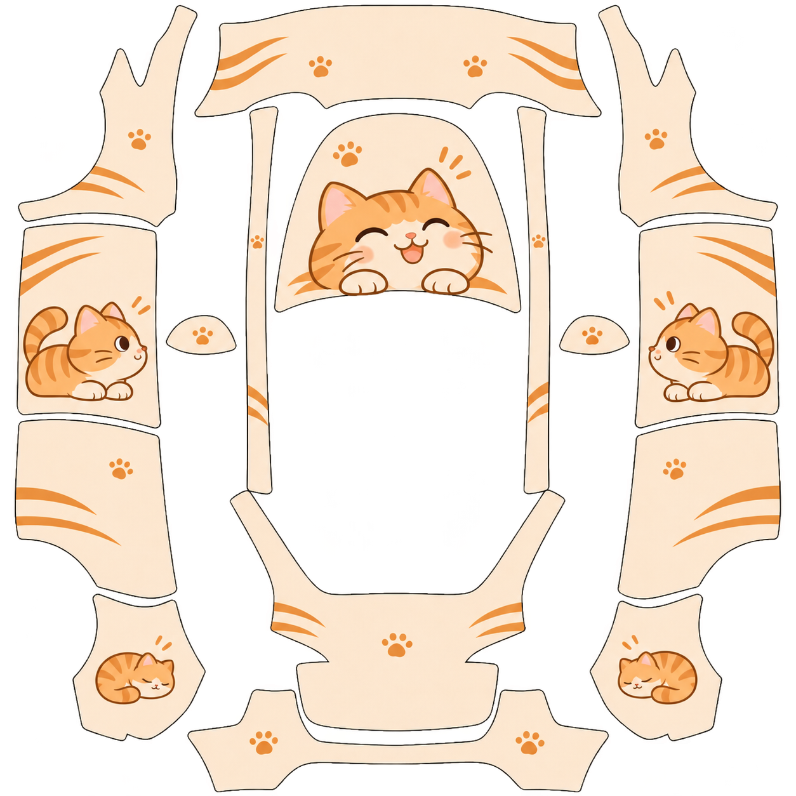

<p align="center">
  
</p>

<p align="center">
  <strong>用一句主题描述，开始制作你的 Model Y 车机皮肤。</strong><br />
  内置白版 · 文字生图 · 对话修改 · 文件校验
</p>

<p align="center">
  <a href="skills/tesla-skin-generator/SKILL.md"></a>
  
  <a href="tests/test_validate_skin.py"></a>
  <a href="LICENSE"></a>
</p>

<p align="center">
  <a href="#安装">安装</a> · <a href="#使用">使用</a> · <a href="#生成示例与实测状态">生成示例</a> · <a href="#检查与测试">检查与测试</a> · <a href="skills/tesla-skin-generator/SKILL.md">技能指令</a>
</p>

---

## 从想法开始

> 用 `$tesla-skin-generator` 生成一款奶油白底、橘猫主题、简洁可爱的 Model Y 皮肤。

TeslaSkin 是运行在支持 Agent Skills 和内置生图能力环境中的技能。它将主题描述、Model Y 固定贴图模板、分区方向规则和文件检查串成一套制作流程。你只需描述想要的设计，无需每次上传白版或准备风格参考图。

| 描述主题 | 生成与修改 | 检查与交付 |
| :--- | :--- | :--- |
| 说出风格、配色和元素，默认制作一款 | 基于内置白版生图，通过对话继续调整 | 检查尺寸、体积和透明范围，保留版本与提示词 |

> **当前状态：实验性。** 技能与检查脚本已可使用，11 项本地测试通过。实测生图在一次修正后仍未满足尺寸、体积和方向要求；当前示例是候选图，尚无通过全部检查的上车成品。详见[验收记录](output/validation-summary.md)。

## 安装

需要支持 Agent Skills 的运行环境、可用的内置生图工具，以及用于校验的 **Python 3 + Pillow**。技能本身不包含生图模型，也不要求单独配置 API Key；无生图工具时会明确说明，不自动切换到付费 API。

### 1. 获取项目

```powershell
git clone https://github.com/isunky/TeslaSkin.git
cd TeslaSkin
python -m pip install -r requirements.txt
```

### 2. 安装到个人 skills 目录

**Windows / PowerShell**

```powershell
$skillsDir = if ($env:CODEX_HOME) {
    Join-Path $env:CODEX_HOME 'skills'
} else {
    Join-Path $env:USERPROFILE '.codex\skills'
}
New-Item -ItemType Directory -Path $skillsDir -Force | Out-Null
Copy-Item -LiteralPath '.\skills\tesla-skin-generator' -Destination $skillsDir -Recurse
```

<details>
<summary>macOS / Linux</summary>

```bash
python3 -m pip install -r requirements.txt
mkdir -p "${CODEX_HOME:-$HOME/.codex}/skills"
cp -R skills/tesla-skin-generator "${CODEX_HOME:-$HOME/.codex}/skills/"
```

</details>

也可下载 [技能 ZIP 包](tesla-skin-generator.zip)，将其中的 `tesla-skin-generator` 文件夹放入个人 skills 目录。安装后在支持该技能的聊天中调用；已有同名技能时，请先备份你的自定义内容。

## 使用

**创建一款皮肤**

```text
用 $tesla-skin-generator 生成一款奶油白底、橘猫主题的 Model Y 皮肤。
简洁可爱，点缀少量猫爪，不要文字。
```

**通过对话继续修改**

```text
底色再淡一点，橘色保持不变。
```

```text
只修改引擎盖，把猫换成睡觉的姿势，其他部位保留。
```

每次制作会保存版本化 PNG、实际提示词和检查结果。示例目录：

```text
output/
├── orange-cat-v01.png
├── orange-cat-v01.prompt.txt
└── orange-cat-v01.validation.json
```

检查失败时最多做一次定向修正，保留前一版本。仍不合格的图片会明确标注为候选图。

## 生成示例与实测状态

<table>
  <tr>
    <td align="center" width="50%"><strong>内置白版 · 几何基准</strong></td>
    <td align="center" width="50%"><strong>橘猫主题 · 修正后候选图</strong></td>
  </tr>
  <tr>
    <td align="center"></td>
    <td align="center"></td>
  </tr>
  <tr>
    <td align="center">1024 × 1024 · 16 个主要白色分区</td>
    <td align="center">未通过检查 · 仅展示设计方向</td>
  </tr>
</table>

2026-11-03 使用内置生图工具实测：

| 检查项 | 目标 | 修正后结果 |
| :--- | :--- | :--- |
| 格式 | PNG | 通过 |
| 尺寸 | 1024 × 1024 | 1254 × 1254，未通过 |
| 体积 | ≤ 1,000,000 字节 | 1,449,204 字节，未通过 |
| 方向与轮廓 | 对应白版及分区规则 | 门板方向未执行，轮廓与透明留空仍需修正 |
| 实车效果 | 车辆导入确认 | 尚未验证 |

生图提示词中的约束不代表模型一定执行。脚本负责文件与几何检查，图案方向、接缝及最终车机效果仍需分别确认。

## 模板规则

- **白版是几何基准。** 固定部位位置、轮廓、细条和透明留空；中心透明洞不能被当作车顶补图。
- **方向按部位处理。** 展开图左右仅指画布位置，不直接推断驾驶员侧；样例中未验证的实际部位对应已单独标记。
- **参考图只帮助理解结构。** `Sample/` 中部分作品的尺寸、透明区和方向不同，不用于替换白版，也不默认继承其风格或角色。
- **只适配当前白版。** 其他年份或车型需要对应模板，不能通过拉伸套用。

完整坐标、方向证据与限制见 [布局规则](skills/tesla-skin-generator/references/layout.md)。

## 检查与测试

检查一张生成图：

```powershell
python skills/tesla-skin-generator/scripts/validate_skin.py output/orange-cat-v02.png
```

另存 JSON 检查报告：

```powershell
python skills/tesla-skin-generator/scripts/validate_skin.py output/orange-cat-v02.png --report output/review.json
```

脚本不修改图片，不覆盖已有报告。退出码 `0` 表示文件检查通过，`1` 表示图片或模板不合格，`2` 表示命令、依赖或报告保存错误。

运行回归测试：

```powershell
python -m unittest discover -s tests -v
```

目前包含 11 项测试，覆盖错误尺寸、超限 PNG、透明背景、中央留空被填入、岛块遗漏、伪装格式、损坏文件、文件名及报告保存行为。

## 项目结构

```text
TeslaSkin/
├── skills/tesla-skin-generator/
│   ├── SKILL.md                # 制作流程与交付规则
│   ├── agents/openai.yaml      # 技能名称与默认调用提示
│   ├── assets/template.png     # 独立打包的固定白版
│   ├── references/layout.md    # 分区、方向、规格与实测限制
│   └── scripts/validate_skin.py
├── tests/                      # 文件与几何检查回归测试
├── output/                     # 候选图、提示词和验收记录
├── Sample/                     # 用户提供的第三方结构参考
├── template.png                # 原始白版
├── vehicle_image.png           # 原始车辆图，技能运行不依赖
└── tesla-skin-generator.zip     # 可携带的技能包
```

## 许可与致谢

项目代码与文档遵循 [Apache License 2.0](LICENSE)。`Sample/` 中第三方示例的图案及角色版权属于各自权利人，不因本项目的软件许可证而重新授权。车型模板、Tesla 名称及相关标识归其权利人所有；本项目为独立社区项目，与 Tesla 无隶属关系。

- [Tesla 官方自定义皮肤模板与规格](https://github.com/teslamotors/custom-wraps)
- [OpenAI Agent Skills 文档](https://learn.chatgpt.com/docs/build-skills)
